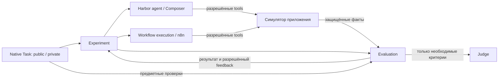

# Workflow Bench — архитектура MVP

**Статус: Предложение на финальный review** · 11 октября 2026 года

Основа — [SPEC.md v0.2](SPEC.md). [PRODUCT_REVIEW.md](PRODUCT_REVIEW.md)
используется как перечень рисков, [Principles.md](Principles.md) — как инженерные
ограничения. Согласованные решения и уточнённый контракт Task синхронизированы
с SPEC и Principles; итог и границы проверки — в §9.
Порядок реализации задаёт [ROADMAP.md](ROADMAP.md). Инженерный дизайн первого
среза WB-02–WB-05 уточнён в §10; это решения текущей design-сессии,
а не реализованные возможности. Термины — в [GLOSSARY.md](GLOSSARY.md).

**Предлагаемый наблюдаемый результат:** Composer исследует разрешённую симуляцию,
сдаёт одну версию параметризованного workflow, а стенд исполняет её на свежих
кейсах и независимо объясняет результат. Изменение бизнес-задачи в пределах
поддержанных контрактов не требует бизнес-правок механизма эксперимента.

Приняты **Task-first**, Harbor Native Task и **один ограниченный native n8n JSON**.
simApp/UI — основное исследовательское направление; API остаётся полноценным
интерфейсом того же состояния. T1 — API-only, T2 — UI-only, T3/T4 — API+UI с выбором
агента. Сначала штатный Codex adapter; **сразу после успешного end-to-end T1 с Codex
проверяется тот же T1 с Sapiens CLI**, до реализации всех четырёх Task.
Собственный compiler, YAML DSL, обязательная Haskell-нотация и Composer HTTP bridge
не нужны. Необходимость custom verifier hook пока не доказана.

Конкретные интерфейсы и размещение ниже — **проектные решения для review**. Сведения
из документации отмечены ссылками. Совместимость и изоляция не проверены запуском;
необходимые эксперименты перечислены в §8.

## 1. Компоненты, ответственность и зависимости

Верхний уровень — **Definition → Experiment → Evaluation**. Это три
ответственности, не требование иметь три файла или три постоянно работающих сервиса.

| Module | Ответственность и Interface | Что остаётся за его пределами |
|---|---|---|
| Definition: native Task | Публичная постановка, схемы параметров/tools, учебные примеры; приватные кейсы, критерии, правила feedback и контрольные workflow | Жизненный цикл Composer и runtime; реализация общего симулятора |
| Environment: симулятор приложения | Наблюдения и действия, единое состояние, проверка прав, журнал эффектов и ошибок; приватное управление экземпляром | Выбор правильного алгоритма Task, score, решение за кандидата |
| Experiment | Фиксация условий, последовательные попытки, сдача версий, свежие кейсы, лимиты, остановка, выбор версии по заданному правилу, отчёт | Знание о правильном получателе, пересылке или шаблоне ответа |
| Composer integration | Перевод публичного задания в вызов Harbor agent, получение артефакта и наблюдаемого lifecycle | Проверки, скрытые кейсы, исправление JSON за модель, оценка качества |
| Workflow execution | Проверка допустимого native-артефакта, технические привязки, настоящий n8n, сбор статуса исполнения | Бизнес-поиск и фильтрация, автоматическое устранение дублей, Judge |
| Evaluation | Вызов предметных проверок Task по защищённым фактам; проверка ответа Judge при необходимости; применение заданной рубрики | Исполнение кандидата, повтор бизнес-действий, самостоятельное назначение весов |

Telegram — общий **предметный Module** в `simapps/telegram/`, вне `src/workflow_bench/`.
У него один владелец состояния: API и виртуальный UI читают/меняют одну модель. UI добавляет
экран, фокус, поиск и черновик. Общую проверку отправки T1/T2 можно разделять в
предметном модуле; критерии и их обязательность по-прежнему задаёт Task.



Стрелки показывают взаимодействие. На уровне импортов `experiment`, `execution`
и общий `evaluation` не импортируют Telegram. Task выбирает окружение своим
native environment config и предоставляет проверяющий скрипт. Telegram зависит
от общих схем обмена, но не от цикла попыток. Общий prompt собирается из публичных
материалов без `if task == T4`; общая оценка принимает результаты критериев без
`if app == telegram`. Entry point получает Task path; app image и профиль берутся
из файлов этой Task. Новая Task не добавляется в список, switch или registry.
Новые предметные проверки размещаются в её `tests/`; менять общий evaluator ради
них не нужно. Повторяющийся код симулятора остаётся в общем app image.

Интеграция Sapiens находится в отдельном пакете
`src/workflow_bench_integrations/sapiens.py`. Направления зависимостей:

```text
cli (точка сборки) → конфигурация запуска + конкретный Harbor agent + Experiment
Sapiens integration → штатный BaseInstalledAgent Harbor + общие contracts
Experiment → общие contracts + Harbor lifecycle через harbor.py
Task → публичные контракты + выбранный app image
```

`cli.py` выбирает реализацию по конфигурации и передаёт её через существующую
границу Harbor; это единственное место сборки, не registry. `experiment.py`,
`execution.py`, `evaluation.py` и `harbor.py` не импортируют интеграцию Sapiens,
не ветвятся по имени агента и не знают команд CORPORA или устройства его памяти.
Общие contracts не импортируют конкретные интеграции. Адаптер подключает внешний
harness, передаёт публичные материалы/tools, обеспечивает файловую сдачу и
наблюдение lifecycle; планирование и внутренние обращения остаются в Sapiens.
Новый Composer требует интеграции и конфигурации запуска, новое приложение —
simApp и Task. Новая Task на прежних возможностях меняет только свой каталог;
её автор не изменяет агента или core. Новая семантика за пределами контрактов
может потребовать их расширения, а не обещания вечной неизменности core.

### Что оставляем Harbor

Native Task остаётся каталогом с `instruction.md`, `task.toml`, `tests/test.sh`
и контрольным `solution/solve.sh`; `environment/` нужен только без готового image. Не вводим базовый класс Task, регистрацию
Task-плагинов или второй формат описания окружения. Дополнительные JSON с кейсами
и рубрикой — данные нашего эксперимента, не замена native Task.
[Harbor Task overview](https://docs.harborframework.com/tasks/overview).

Harbor отвечает за создание/удаление sandbox, запуск агента, копирование
объявленных артефактов и штатные логи. Наш внешний последовательный цикл нужен
для нескольких версий, нескольких свежих кейсов на версию и отдельного holdout.
Один Harbor trial с Composer соответствует одной попытке сдачи; replay одного
кейса не считается новой генерацией. Итоговая проверка не вызывает Composer.

**Custom verifier hook — условное решение, не обязательный компонент.** Сначала
в E1 проверяем связывание штатных операций с host: получить артефакт агента,
выполнить replay в другом Harbor sandbox и передать защищённые факты штатному
отдельному verifier до запуска `tests/test.sh`. Ни вложенный Harbor, ни n8n,
ни Docker socket внутри `tests/test.sh` не появляются.

E1 проверяет достаточность штатного lifecycle, измеряя именно передачу артефакта,
запуск отдельного replay и доставку защищённых фактов. Если необходимые операции
недоступны из стандартного flow без нового управляющего сервиса или небезопасного
доступа, допускается один host-side `BaseVerifier` hook. Он только связывает фазы,
а предметный `tests/test.sh` остаётся в Task. Не пишем оба пути заранее и не
копируем Harbor Trial. Точная точка вызова — оставшееся техническое предположение,
которое надо закрыть первым малым экспериментом, а не объявлять доказанным сейчас.
Harbor действительно предоставляет custom verifier seam:
[Harbor custom verifiers](https://docs.harborframework.com/jobs/custom-verifiers).

## 2. Контракты между компонентами

Названия полей ниже определяют смысл обмена; форма первого среза уточнена в §10.
Сами JSON Schema создаются в соответствующих coding-тикетах.
Версии схем фиксируются до эксперимента. JSON на внешних границах валидируется;
исполняемый код из артефакта никогда не используется для его валидации на host.

### Task и условия эксперимента

| Передача | Содержание | Доступ |
|---|---|---|
| Task → Composer | Постановка, схема входа, контракт workflow, описания разрешённых tools и ошибок, учебные данные, публичные правила и пределы UI | Только публичный пакет |
| Task → Experiment | Native Task path; выбранный профиль; ссылки на фиксированные наборы кейсов; версии данных | Доверенный host |
| Кейс → replay | Типизированные рабочие параметры; исходное состояние передаётся симулятору, а не в workflow | Workflow видит параметры и разрешённые наблюдения |
| Task → Evaluation | Ожидания, критерии и ссылки на предметные проверки; рубрика и политика раскрытия feedback | Только доверенная сторона |
| Владелец эксперимента → Experiment | Harness/model/config, конечные лимиты, правило успеха/выбора, условия продолжения при неполной оценке | Фиксируются до запуска; публичная часть лимитов передаётся Composer |

**Три вида данных и их передача.** `task.json` содержит публичную схему входа
и разрешённый учебный пример, а не полный проверочный кейс или решение.

| Данные | Кому и когда передаются |
|---|---|
| **А. Дано пользователем**: рабочие параметры просьбы | Composer видит схему и пример; каждый replay получает только `case.input` и технические привязки tools/capability |
| **Б. Нужно узнать из приложения**: чаты, сообщения, дерево и эффект действий | Исходное `case.state` загружается только в Simulator; workflow получает сведения через разрешённые tools, а не через скрытую подстановку state |
| **В. Известно проверяющему**: ожидания, контрольные результаты и проверочный код | Только доверенные host/verifier; verifier получает также защищённые факты выполнения |

На exploration Composer получает `instruction.md`, input schema, разрешённый
пример, общие контракты и описания tools, доступ к учебному экземпляру Simulator.
В §6 `example.state` — явно публичный синтетический учебный мир: целиком входит
в экспорт примера Composer и инициализирует только exploration. Приватные
`cases[*].state` никогда не экспортируются в этот пакет. Replay даже учебного
контроля получает только input и bindings, не весь example/case.

Поле `task.json.feedback` — **правила раскрытия**, которые читает Experiment при
подготовке feedback, и публичное описание этих правил для Composer. Это не
результаты: они появляются после исполнения и Evaluation. При следующей попытке
сохраняются публичный пакет и предыдущий артефакт; единственный новый материал
из проверки — разрешённый feedback. Ни case dumps, ни приватные ожидания,
ни память чужих запусков не переносятся.

| Task | Дано пользователем → узнать через tools → приватно проверить |
|---|---|
| T1 API | Готовый однозначный `chat_id` и точный текст → существование чата/наблюдаемый эффект отправки → правильный адресат, ровно одна отправка, точный текст, честный отказ/неопределённость, сохранность остальных данных |
| T2 UI | Публичное обозначение выбранного чата и текст, достаточные по профилю UI → найти чат и элементы в свежем дереве, проверить эффект → адресат, текст, отсутствие дублей/посторонних изменений и API-обхода |
| T3 API+UI | Выбранный чат, публичные условия и шаблоны ответа → последнее входящее и относящиеся к условиям данные → выбор ветви, точное применение шаблона или отсутствие отправки, сохранность данных |
| T4 API+UI | Указанные чаты и ключевое слово, публичные правила отбора и назначения Saved Messages → сообщения, их происхождение и уже пересланные объекты → полный отбор и пересылка в Saved Messages, сохранённое происхождение, отсутствие дублей и лишних пересылок |

T1 с готовым ID проверяет отправку, **не поиск человека**. Отдельный поясняющий
пример: если вход содержит уникальный username или достаточный контекст, workflow
может найти технический ID через разрешённое чтение чатов. Это не пятая Task MVP.
Различаем уже однозначного получателя, определимого по доступному контексту и
неопределимого из разрешённых данных. Во втором случае поиск — часть решения;
в третьем workflow следует публичному правилу отказа без ошибочной отправки.
«Найди Anna» при двух неразличимых Anna не даёт права угадывать ID или брать его
из expected. Нужный контекст явно присутствует во входах/наблюдениях кейса.
Диалог уточнений, персональная долговременная память, универсальное разрешение
идентичности и runtime LLM в этот контракт не добавляются.

Условия сохраняются одним manifest: идентификаторы/версии Task, профиля tools,
наборов, рубрики, runtime и harness; лимиты и утверждённые правила. Источник
рубрики — `tasks/<task>/tests/rubric.json`; manifest сохраняет её применённый
снимок и hash, не служит вторым местом авторства. Секреты в него
не входят. Хешируются артефакты и существенные входы измерения, а не весь checkout.
Пока методика не задана, допустим технический контроль, но не оцениваемый запуск
с придуманными defaults для score, stop или выбора версии.

### Tools и окружение

Общий Interface операции: `tool name + schema version + JSON arguments` →
`call_id + result | structured error`. Описание tool содержит схему ответа,
публичную семантику, чтение/запись, пределы, ошибки, наличие или отсутствие
идемпотентности и доступных способов узнать эффект. Имена бизнес-операций
принадлежат окружению; core их не интерпретирует.

Run/case/actor, профиль доступа, срок действия и счётчик вызовов определяет
сервер по выданной capability, а не по произвольным полям кандидата.
Отдельные capabilities выдаются exploration и каждому replay. Для UI-only
сервер отклоняет бизнес-API даже при прямом HTTP-запросе. Описания tools
не являются механизмом авторизации.

Предлагается один процесс симулятора с тонкими MCP и HTTP входами над теми же
операциями: MCP для штатного Codex, HTTP Request для n8n. Это транспорт
инструментов, не отдельный Composer bridge и **не app-level simMCP**.
simApp/UI — основное направление исследования: виртуальные наблюдения и действия
в стиле Blindly без настоящего GUI/ОС. API остаётся вторым полноценным доступом
к тому же состоянию. Возможный предметный simMCP сейчас не реализуется отдельной
подсистемой; MCP-транспорт сам по себе не добавляет третий бизнес-интерфейс.
Admin reset/freeze/export/revoke
не публикуется как tool: отдельный защищённый control-доступ есть только у host.
Его credentials, state-файлы и журнал не попадают в кандидатские контейнеры.

Tool error различает, например, `invalid_arguments`, `not_found`, `ambiguous`,
`stale_observation`, `forbidden`, `limit_exceeded` и `transport_unknown`.
Отсутствие HTTP-ответа не означает отсутствие эффекта. Публичный ответ не выдаёт
внутренний commit-факт, если соответствующее наблюдение не предусмотрено профилем.
Доверенный журнал отдельно сохраняет принятие, эффект и доставку ответа, насколько
это известно симулятору. Универсального автоматического retry записи нет.

### Composer и сдача версии

Вход попытки: публичный пакет, capability exploration, лимиты и, при исправлении,
предыдущий артефакт с разрешённым feedback. Выход `CompositionResult`:

- идентичность harness/model/config и ID вызова/сессии, если наблюдаются;
- `artifact` — сохранённые байты либо отсутствие; `artifact_status` —
  `valid`, `invalid` или `missing`, ошибки контракта;
- `status` — `completed`, `failed`, `timed_out`, `cancelled` или `unknown`;
- `stop_requested`, `stop_confirmed`, причина, наблюдаемые timestamps;
- ссылки на исходные логи и доступные usage-метрики с признаком полноты.

Рабочий путь сдачи — один заранее заданный файл `workflow.json`, объявленный
артефактом Harbor. Финальное сообщение модели не подменяет этот файл. Host
проверяет размер, обычный тип файла и JSON; не следует symlink/path traversal,
не распаковывает произвольные архивы. После подтверждённого прекращения записи
копирует байты в каталог версии и вычисляет hash. Незавершённый файл при timeout
может сохраниться для диагностики, но автоматически принятой версией не становится.
Adapter не чинит JSON и не делает скрытую повторную генерацию.

### Workflow и исполнение

Вход runtime — валидированный native workflow, его hash, параметры кейса,
служебные привязки tools/capability, профиль и конечные лимиты. Версия содержит
неизменную бизнес-логику. Runtime заменяет только объявленные технические слоты
входа и адреса/доступа, сохраняя исходный и привязанный hash с перечнем замен.
Это подстановка данных, не compiler и не изменение ветвей решения.

Выход `ExecutionResult` разделяет:

- статус запуска/процесса и подтверждение остановки;
- заявление workflow: `completed`, `refused`, `unknown` либо отсутствие,
  результаты и технические ошибки;
- доверенные ссылки на начальное/конечное состояние, события tools и нарушения;
- время runtime отдельно от подготовки среды, API/UI-вызовы, известные затраты.

`exit 0`, сообщение «отправлено» и лог n8n не доказывают бизнес-успех.
Обоснованный отказ при неоднозначном адресате может быть правильным результатом
Task; только её критерии определяют это. И наоборот, фактическая отправка может
сосуществовать с потерянным ответом и ошибкой исполнения.

### Evaluation и feedback

Evaluation получает manifest, результаты исполнения и защищённый evidence bundle.
Bundle связывает run/attempt/version/case/profile со snapshot до/после и
монотонным журналом событий. Host получает его непосредственно от симулятора
после freeze, сохраняет один раз и передаёт verifier read-only. Файл, который
кандидат назвал `evidence.json`, не является таким источником.

Предметная проверка возвращает для каждого `criterion_id` наблюдение/значение,
статус `pass | fail | unknown | not_applicable`, объяснение и evidence refs.
Обязательность и критичность берутся из заранее заданной рубрики, не из ответа
кандидата или Judge. Общий код применяет утверждённый способ расчёта.

`EvaluationResult` содержит `score: 0..10 | null`, отдельный
`verdict: pass | fail | unknown`, `completeness`, разбивку критериев,
критические нарушения и ошибки среды. Известный критический fail сохраняется
при неполном score; отсутствие обязательной оценки исключает pass. Численные
веса, partial credit, пороги, caps и агрегация здесь **не назначаются**.

Judge, если необходим конкретному критерию, получает фиксированную рубрику и
минимальный evidence, без tools исполнения. Его ответ — значение критерия,
объяснение и ссылки. Код проверяет формат, диапазон и существование ссылок;
семантическую пригодность проверяет отдельный эксперимент E5. Недоступный или
непригодный Judge оставляет полный score отсутствующим; повтор оценки использует
те же факты без replay. Условия такого повтора и бюджет задаются заранее.

Feedback — отдельная разрешённая проекция результата: ID публичного требования,
разрешённая категория неуспеха и безопасная техническая диагностика. Не пересылаем
сырой stderr verifier, stack trace с fixture, приватные значения, эталон и bundle.
В итоговой фазе эта проекция вообще не передаётся Composer.

**Сопряжение с Harbor reward требует явного преобразования.** Штатный parser
проверенного исходника принимает числовые значения, но не `null` внутри
`reward.json`. Его `VerifierResult.rewards` допускает отсутствие всего словаря.
Поэтому полный результат хранится в нашем evaluation JSON; числовой reward
выдаётся только при полной вычисленной оценке. При custom hook возможен
`rewards=None`; у стандартного verifier отсутствие reward означает ошибку оценки,
которую внешний отчёт обязан сохранить как incomplete, не как провал кандидата.
Не создаём фиктивный ноль и не выдаём стандартное среднее Harbor за итог
эксперимента. Проверить сохранение этого различия в E1.
[Verifier parser](https://github.com/harbor-framework/harbor/blob/dc933be707feafbb9efcdf092cb8a0e391332617/src/harbor/verifier/verifier.py),
[VerifierResult](https://github.com/harbor-framework/harbor/blob/dc933be707feafbb9efcdf092cb8a0e391332617/src/harbor/models/verifier/result.py).

## 3. Полный flow, процессы и данные

### Размещение и доступ

| Место | Процессы и данные | Разрешённые соединения |
|---|---|---|
| Доверенный host | Experiment, Harbor, manifest, приватные Task-файлы, каталог результатов, handles собственных ресурсов | Управление sandbox и control-интерфейсом симулятора |
| Composer sandbox | Выбранный harness (Codex CLI или Sapiens host+CLI), чистое рабочее дерево из публичного пакета, временная сессия, сдаваемый файл | Только exploration-tools и нужный модельный endpoint |
| Replay sandbox | n8n с новой локальной БД; workflow, параметры, capability текущего кейса | Только tool-интерфейс текущего симулятора и собственный n8n runner |
| JS runner sidecar | Готовый external task runner n8n; выполнение Code nodes | Свой broker; без приватных volumes и доступа к control-интерфейсу |
| Симулятор | Общее API/UI-состояние текущего кейса, журнал, профиль прав | Tools для кандидата; отдельно защищённое управление host |
| Отдельный verifier sandbox | `tests/`, ожидания, read-only факты, расчёт критериев/score | Judge endpoint только если нужен; кандидатских процессов нет |

На фазе replay Composer sandbox уже остановлен, его capability отозвана.
Симулятор exploration не переиспользует изменённый мир для проверок.
Verifier не импортирует candidate-модули, не вызывает n8n и не исполняет строки
из workflow. Docker socket доступен только доверенному host. Кандидату не
монтируется checkout, каталог результатов, личный home, tests или solution.

Harbor по умолчанию запускает verifier рядом с агентом; это непригодный для нас
default. Нужно явное separate-размещение в чистом окружении; отдельный dedicated image
не обязателен (вариант общего чистого образа — §6). Копирование
agent artifacts в него разрешает читать JSON, но не делает их доверенными.
[Separate verifier](https://docs.harborframework.com/tasks/separate-verifier).

Контейнеры создаются для конкретного run с уникальными именами. Симулятор —
действительно необходимый соседний процесс, external runner — готовый механизм
n8n; собственного API для управления n8n, очереди и постоянно работающего сервера
экспериментов нет. Harbor поддерживает Compose и sidecars; точную передачу
protected evidence и teardown проверяем, а не выводим из наличия Compose.
[Multi-container](https://docs.harborframework.com/tasks/multi-container).

Сеть replay не имеет Internet/host egress; разрешены только нужные внутренние
соединения. Control listener симулятора отделён от tools и требует отдельный
секрет; кандидатский token не даёт reset/export/freeze. Ограничения применяются
также к runner, не только n8n main. Composer egress ограничен модельным провайдером
и exploration. Образы готовятся заранее, чтобы setup не требовал открытой сети
во время измерения. Docker allowlist Harbor зависит от Linux/nftables; действие
политик на выбранном Docker host и sidecars — обязательная проверка E1.
[Network policies](https://docs.harborframework.com/tasks/network-policies).

### Последовательность

1. **Зафиксировать условия.** Проверить наличие рубрики, правил выбора/feedback,
   лимитов и разрешения на модельные вызовы. Создать run manifest и каталог.
   Отдельно подготовить публичный export Task; приватные файлы не попадают даже
   в build context образа Composer. Ошибка среды на этом шаге не даёт score=0.
2. **Исследование.** Harbor запускает чистый Composer sandbox и исследовательский
   симулятор. Codex читает наблюдения и пробует действия в пределах лимитов.
   Все вызовы учитываются. Состояние exploration не служит результатом решения.
3. **Сдача.** Дождаться наблюдаемого завершения; отозвать доступ к tools,
   подтвердить отсутствие активных процессов/записей. Получить и проверить файл,
   зафиксировать версию. Невалидность — результат попытки; неопределённость
   вызова Composer не разрешает Experiment автоматически отправить prompt повторно.
4. **Свежие кейсы для исправлений.** Для каждого кейса последовательно создать
   новый replay sandbox и симулятор из fixture, включая UI/черновик. Внести только
   рабочие параметры и служебные привязки. Импортировать workflow и реально
   исполнить его n8n. Изменённая БД n8n/static data также не переносится между
   кейсами. До исполнения зафиксировать исходный snapshot.
5. **Закрыть кейс и оценить.** Закрыть приём новых действий, дождаться завершения
   уже принятых операций либо отметить неизвестность, остановить runtime, получить
   конечное состояние/журнал. Отдельный verifier проверяет зафиксированные факты.
   Неизвестная остановка или утраченная доверенность не дают валидный полный успех.
6. **Исправление.** Experiment применяет заданные stop/selection rules. Если
   исправление допустимо, новая попытка получает прежний артефакт, разрешённое
   знание и feedback, но свежий sandbox и мир. При обязательном отсутствующем Judge
   предлагается остановить цикл оценки до разрешённого продолжения; это политика
   для фиксации владельцем, не повод придумать feedback или новые критерии.
7. **Итог.** Зафиксировать выбранную версию до раскрытия holdout. Запустить тот же
   replay/evaluate путь на итоговых кейсах. Никакого выбора победителя или
   исправления по этим результатам. При отсутствии пригодного артефакта это
   записывается явно; не подставляется более ранний «лучший» без принятого правила.
8. **Отчёт и cleanup.** Сохранить результат кейсов/попыток, причины, версию,
   затраты и неизвестные поля. Удалить только ресурсы этого run после сбора фактов.
   Ошибка cleanup видна в отчёте и не скрывает незавершённую работу.

Лимиты есть у Composer, tool call, workflow, verifier, Judge и всего эксперимента.
Host измеряет wall time; симулятор независимо ограничивает число/срок вызовов.
При отмене сначала запрещаются новые tool-действия, затем прекращается процессная
работа через Harbor; после grace period принудительно останавливаются собственные
контейнеры. Проверяются также принятые операции и runner-процессы. Отмена ожидания
не равна отмене работы; при отсутствии подтверждения `stop_confirmed=false`.
Уже сделанные изменения не объявляются откатанными.

Каталог `runs/<id>/` — локальный, не коммитится. Manifest и общий отчёт ссылаются
на штатные Harbor trial logs/artifacts; snapshots, evaluation и feedback добавляются
рядом как недостающие предметные записи, без второго полного дерева логов.
Приватные результаты не монтируются в следующий Composer. Токены с отсутствующей
статистикой остаются `null`; стоимость рассчитывается лишь по записанным известным
ценам. Создание, replay, Judge и подготовка инфраструктуры отражаются раздельно.

## 4. Composer: штатная граница прежде собственного адаптера

### Что установлено чтением

Harbor различает installed agent, работающий внутри task environment, и external
agent, управляющий им снаружи. Для CLI рекомендует `BaseInstalledAgent`.
Это уже подходящий seam для смены harness, отдельная иерархия Composer не нужна.
[Custom agents](https://docs.harborframework.com/agents/custom-agents).

Проверенный штатный Codex adapter поддерживает конфигурацию MCP servers,
запускает `codex exec --json`, собирает сессии и usage. Он использует
`--dangerously-bypass-approvals-and-sandbox`: ограничения обязана обеспечить внешняя
среда. В исходнике есть нормализация отсутствующих token counts через `or 0`;
для нашего отчёта надо сохранять различие missing/zero по исходным событиям.
Это небольшой перевод результата, не основание переписывать agent loop.
[Harbor Codex source](https://github.com/harbor-framework/harbor/blob/dc933be707feafbb9efcdf092cb8a0e391332617/src/harbor/agents/installed/codex.py).

Официальная документация Codex подтверждает non-interactive запуск, JSONL events,
MCP events, финальный output file и output schema. Наличие этих механизмов не
доказывает остановку дочерних процессов и полноту usage при аварии.
[Codex Exec](https://developers.openai.com/codex/noninteractive/).

### Решение для первого пути

Использовать штатный Harbor Codex adapter с закреплённой версией, task MCP
и файловым контрактом сдачи. Наш код задаёт публичный пакет, параметры и лимиты,
проверяет результат, фиксирует неизвестность и контролирует остановку. Специальный
Codex adapter сейчас не нужен: не выявлена функция создания workflow, требующая
иного model loop. Если E2 обнаружит невозможность передать config, корректно
получить файл или наблюдать завершение, допускается минимальная поправка именно
в Harbor seam с описанием воспроизводимого ограничения.

HTTP bridge к Codex не нужен: installed CLI уже запускается в управляемой среде.
Он не устраняет проблему cancel, а добавляет удалённую заявку и неопределённость
доставки. MCP/HTTP симулятора остаются транспортом tools, а не прокси к модели.

У каждой попытки чистые workspace, home/config/session storage. Не монтируем
пользовательские skills, память, MCP-конфигурации и служебные инструкции репозитория.
Между исправлениями передаём только явно сохранённые публичные материалы,
предыдущий workflow и разрешённое знание; автоматический `resume --last` не нужен.
Auth передаётся только выбранному Composer окружению и никогда replay/verifier;
ключ Judge — только стороне оценки. Доступный Composer credential имеет конечный
внешний лимит, поскольку shell в его sandbox способен читать своё окружение.
Локальный timeout не гарантирует прекращение уже принятого провайдером вычисления:
неизвестный расход остаётся неизвестным, Experiment не повторяет вызов автоматически.

Retry-политика имеет три разных владельца:

| Уровень | Правило |
|---|---|
| Experiment → Composer | Вызов с неизвестным исходом автоматически не повторяется. Адаптер не добавляет скрытые попытки, исправления или собственный repair loop; разрешённая следующая попытка видна в эксперименте |
| Workflow → API/UI | Запись не повторяется вслепую; решение проверяет эффект разрешёнными наблюдениями либо фиксирует неопределённость по публичному контракту |
| Внутри harness/CLI/SDK | Это часть исследуемого Codex/Sapiens. Фиксируем версию, доступную retry-конфигурацию, фактические метрики и пределы наблюдаемости; не требуем переписать стороннего агента ради полного контроля provider retries |

В E2/E3 выясняем, какие внутренние обращения видны и какие остаются неизвестными.
Один запуск harness не объявляется одним модельным запросом. Ограничения доступа,
конечные лимиты и подтверждение фактической остановки обязательны независимо от
наблюдаемости retries; неизвестные затраты не превращаются в ноль.

### Ранняя интеграция Sapiens: что действительно есть в коде

11 октября 2026 года через GitHub API проверен текущий `main` Sapiens:
`71e93cb3de00183c263ec440919b313cf92ed8af`. Это тот же commit, что в review;
ниже заново проверены **исполняемые исходники**, а не только CLI-спецификация.

| Аспект | Прочитанная реализация | Следствие для интеграции / что ещё не доказано |
|---|---|---|
| Host | `cli_transport.Client` только обращается к уже запущенному loopback host; `__main__` имеет `--data-dir`, `--port`, требует frontend assets | CLI и отдельный CORPORA host размещаются вместе в управляемом sandbox; готовность Linux image без desktop пока не проверена |
| Состояние/память | `Service(data_dir)` хранит SQLite, `agentpy`, workspaces; `Conversation.context` использует историю/manifests, `Notes` хранит заметки | Нужны свежие data-dir, home и provider sessions; смена только workdir не изолирует память |
| Tools | CLI chat передаёт текст/flow, а не allowlist tools. В выбранном Codex backend наследуется окружение, включён bypass sandbox; host формирует computer-use/host-control context | Готовой передачи нашего allowlist через CLI здесь не установлено. В E3 проверяем отдельный config backend с транспортом наших tools и внешнее ограничение сети/файлов; desktop недоступен физически |
| Артефакт | Backend запускается в workspace Sapi и допускает файловые действия; CLI возвращает output/status, специального экспорта workflow нет | Adapter задаёт путь сдачи внутри workspace; после stop получает обычный файл через Harbor, а не извлекает JSON из произвольного ответа |
| Завершение | CLI сохраняет ID принятого turn и наблюдает связанный workload; различает completed/failed/interrupted/waiting | Accepted не равен completed. WaitingForAdmin — незавершённая попытка, не успех и не повод добавлять скрытые уточняющие вызовы |
| Cancel/timeout | Host `turn_action` и `TurnRunner.cancel` устанавливают событие отмены; локальный Codex watcher останавливает дерево процессов. У delegated call есть отдельные ограничения cancel | Это реально реализованный путь отмены, но не доказательство остановки всей CORPORA. Ctrl-C CLI лишь отсоединяет наблюдателя; проверить child calls и фоновые действия обязательно |
| Внутреннее проектирование | `delegation.py` реализует Call/Triage/Delegation с decision prompts и журналом; файл прямо описывает flow без WorkGraph. Haskell-документы не доказывают наличие соответствующего runtime | Используем реализованный harness; не объявляем его исполнителем всех спецификаций и не требуем Haskell-артефакт |

Первоисточники:
[CLI transport](https://github.com/aleski-green/sapiens4/blob/71e93cb3de00183c263ec440919b313cf92ed8af/sapiens/corpora/host/cli_transport.py),
[CLI observation](https://github.com/aleski-green/sapiens4/blob/71e93cb3de00183c263ec440919b313cf92ed8af/sapiens/corpora/host/cli.py),
[host entry point](https://github.com/aleski-green/sapiens4/blob/71e93cb3de00183c263ec440919b313cf92ed8af/sapiens/__main__.py),
[Service](https://github.com/aleski-green/sapiens4/blob/71e93cb3de00183c263ec440919b313cf92ed8af/sapiens/corpora/host/service.py),
[Conversation](https://github.com/aleski-green/sapiens4/blob/71e93cb3de00183c263ec440919b313cf92ed8af/sapiens/corpora/sapis/conversations.py),
[Notes](https://github.com/aleski-green/sapiens4/blob/71e93cb3de00183c263ec440919b313cf92ed8af/sapiens/corpora/sapis/notes.py),
[TurnRunner](https://github.com/aleski-green/sapiens4/blob/71e93cb3de00183c263ec440919b313cf92ed8af/sapiens/runtime/turns.py),
[Codex backend](https://github.com/aleski-green/sapiens4/blob/71e93cb3de00183c263ec440919b313cf92ed8af/sapiens/runtime/codex.py),
[Delegation](https://github.com/aleski-green/sapiens4/blob/71e93cb3de00183c263ec440919b313cf92ed8af/sapiens/corpora/host/delegation.py).

Минимальное проектное решение — один Sapiens `BaseInstalledAgent` adapter
в `workflow_bench_integrations/sapiens.py`,
который запускает выделенный host+CLI в среде Harbor, связывает lifecycle и
файловую сдачу с CompositionResult. HTTP bridge поверх CLI не создаётся.
У host есть pulse/очереди и восстановление работы: после terminal outcome надо
отозвать tools и завершить весь выделенный host с дочерними процессами, а не
оставить личный CORPORA работать в фоне. Если E3 выявит невозможность такого
размещения, фиксируется конкретный blocker и минимальная нужная адаптация;
универсальная платформа агентов не строится.

Оба Composer получают одинаковые бизнес-требования, публичные данные, профиль
tools и контракт `workflow.json`. Codex проектирует своими средствами; Sapiens —
своими реализованными внутренними механизмами. Общий prompt и `instruction.md`
не содержат Haskell-нотации, WorkGraph или требований к внутренним этапам Sapiens.
В отчёте фиксируются harness/backend/model, конфигурация памяти, внутренние
модельные обращения и ограничения метрик. Даже Sapiens поверх Codex — другой
harness, а не эксперимент с «чистой заменой модели».

**Порядок фиксирован:** первый успешный T1/Codex → немедленно тот же T1/Sapiens.
Это два независимых мира с одинаковыми fixtures, Task, n8n и Evaluation.
Первый Codex-запуск не ждёт Sapiens; после него проверка Sapiens не откладывается
до T2–T4. Сейчас adapter лишь описан; Sapiens **не подключён и не проверен запуском**.

## 5. Workflow: проверка baseline и рекомендуемый формат

### Принятый формат и его достаточность

**Ограниченный native n8n JSON принят для MVP.** Composer сдаёт `workflow.json`,
benchmark валидирует и привязывает входные данные, n8n исполняет. Typed graph,
YAML DSL и compiler не реализуются. Предыдущий baseline уже допускал JavaScript
и n8n expressions: второй формат не давал доказанной дополнительной безопасности,
но требовал отдельного перевода. Это обоснование принятого решения, а не новый
выбор между двумя форматами.

| Требование | Поддерживаемая семантика и проверка |
|---|---|
| T1 | Параметры нового кейса передаются неизменному workflow; verifier проверяет адресата, текст и ровно один эффект |
| T2 | Читать текущее дерево, искать по публичным признакам, проверять идентичность/число совпадений; после изменения экрана читать заново, не сохранять постоянный path |
| T3 | If/детерминированный код применяют публичные правила и шаблоны; runtime LLM отсутствует |
| T4 | Обработать 0/1/N items, сохранить происхождение `(source_chat, source_message)`, исключить уже пересланные по наблюдениям; для stateful UI выполнять действия последовательно |

n8n документирует items, If/loop connections и Loop Over Items. Наличие
примитивов подтверждено документацией, их достаточность для наших профилей
подтверждает только E4. Особенно проверяются пустой результат, item context,
динамическое дерево и предел выборки.
[Loops](https://docs.n8n.io/flow-logic/looping/),
[Loop Over Items](https://docs.n8n.io/integrations/builtin/core-nodes/n8n-nodes-base.splitinbatches/).

Runtime-контракт не делает n8n JSON переносимым в другой движок. Замена n8n
потребует решения о формате/миграции, повторной проверки контролей и новой серии
измерений. Второй backend или converter заранее не создаются. При фундаментальном
отказе сохраняются минимальный native-артефакт, fixtures, версии и ошибка E4;
новый DSL самостоятельно не вводится. Синхронизация SPEC/Principles — в §9.

### Минимальный профиль артефакта

Разрешённый набор native nodes: Manual Trigger, Edit Fields/Set, HTTP Request,
Code (только JavaScript), If, Loop Over Items. Один заранее описанный вход
`BenchInput` получает параметры и служебные привязки; результат выражается обычными
данными в терминальном `BenchResult`. Эти роли не являются новыми custom nodes.
Пустая выборка имеет явную ветвь завершения без фиктивной отправки. При циклах
workflow должен иметь условие выхода; внешний deadline и лимиты остаются обязательны.

Validator проверяет размер и структуру, разрешённые node types/versions/options,
рёбра и входные/выходные слоты. Запрещены credential references, pinData,
сохранённое static state, дополнительные triggers, Execute Command, файловые,
внешние workflow, LLM и произвольные integrations. HTTP направлен только к
tool endpoint своего экземпляра; method/path и профиль проверяет также сервер.
Автоматические retries HTTP/n8n отключены; восстановление неоднозначного эффекта
возможно только по публичному контракту операции и логике workflow.

Code и expressions — недоверенные программы. Они нужны для обхода дерева,
фильтрации, сопоставления идентичности и шаблонов, выбранных Composer. Не пишем
собственный JS interpreter и не обещаем доказать безопасность поиском запрещённых
подстрок. Используем готовое исполнение n8n и внешнюю изоляцию, ограничения ресурсов,
модулей, сети и файлов. Даже захваченный runtime не должен видеть tests/evidence/admin.
[Code node](https://docs.n8n.io/integrations/builtin/core-nodes/n8n-nodes-base.code/).

Для Code nodes предлагается готовый external JS task runner n8n, без установки
кандидатских npm packages. n8n и runner получают совместимые закреплённые версии.
Это дополнительный готовый sidecar из-за исполнения недоверенного JS, не наша
очередь или общий backend. Поддержку этого режима вместе с Server CLI надо
подтвердить в E1, а не предполагать по двум независимым страницам документации.
[Task runners](https://docs.n8n.io/hosting/configuration/task-runners/).

Один способ исполнения: импорт в свежую локальную БД и Server CLI
`n8n execute --id …`; постоянно работающий editor/API server не нужен по замыслу.
Документация подтверждает команду исполнения, но не весь выбранный набор настроек.
Доступ к env/files в nodes ограничивается дополнительно; наличие настройки не
заменяет отсутствие секретов в replay sandbox.
[Server CLI](https://docs.n8n.io/hosting/cli-commands/),
[Security configuration](https://docs.n8n.io/hosting/configuration/environment-variables/security/).

### Предметный профиль UI и пределы обобщения

Предлагаемый класс изменений — перестановки, допустимые обёртки дерева, другие
данные/экран/черновик при сохранённых публичных семантических признаках. Дерево
показывает только текущий наблюдаемый UI. Handle привязан к наблюдению/ревизии,
не является постоянным скрытым ID. При недостатке признаков для различения
одноимённых получателей workflow отказывает по публичному правилу, а не угадывает.

Автор Task должен согласовать конкретные признаки идентичности, правила очистки
черновика, наблюдения после отправки, поиск ключевого слова, полноту выборки и
верхние пределы. Это открытые детали профиля из SPEC §13. Предложение — конечные
полные выборки в публичных пределах; пагинация добавляется только если входит
в утверждённый профиль. Превышение обозначается явно. Произвольный редизайн UI
и неограниченные массивы не обещаются.

Готовые инструменты предоставляют наблюдения и элементарные действия, но не
`reply_by_rules`, `forward_all_matches` или `send_to_correct_recipient`.
Например, T4 выбирает совпадения и сравнивает provenance в своём workflow;
симулятор лишь достоверно реализует чтение/пересылку и сохраняет происхождение.

**Берём готовое:** Harbor native Task/agent/environment/verifier seams,
Docker/Compose, Codex Exec, n8n nodes/CLI/JS runner, обычную JSON-валидацию,
Python/uv для собственного кода. **Пишем сами:** небольшой цикл эксперимента,
связку replay с native verifier, validator и binder одного формата, Telegram
state/API/UI с защищённым журналом, Task-данные/проверки, нормализацию результата,
feedback и необходимый Judge client. Чужие подсистемы не переносятся.

## 6. Структура, заполненный пример T1 и добавление Task

Расположение будущего кода; пустые каталоги сейчас не создаются:

```text
src/workflow_bench/
  definition.py       # чтение Task и явный public export (WB-03)
  experiment.py       # последовательность попыток/кейсов и отчёт
  execution.py        # validator, технические привязки, запуск n8n
  evaluation.py       # общие результаты критериев, заданная рубрика, Judge
  harbor.py           # соединение штатных операций; hook только если нужен E1
  contracts.py        # типы уже проверенных данных обмена
  cli.py              # получает Task path и конфигурацию Composer
  resources/          # единственный источник общих JSON Schema/публичных текстов
    workflow.md
    workflow.schema.json
    composer.md        # нейтральный contract + instruction + tools + feedback
src/workflow_bench_integrations/
  sapiens.py          # внешний Sapiens через Harbor agent seam, при раннем T1
simapps/telegram/     # отдельный предметный пакет: state, API, UI, tools
  ...                # общая реализация для T1–T4, собственный image
environments/       # общие реально используемые images/configs
tasks/
  t1-send-message/   # раскрыт ниже
  t2-ui-message/
  t3-conditional-reply/
  t4-smart-forwarding/
tests/              # тесты проекта, включая integration fixtures других apps
docs/implementation/ # тикеты разработки, не benchmark tasks
runs/               # локальные результаты вне Git
```

Task зависит от контрактов и выбранного app image. `simapps/telegram` может
использовать общие структуры tool/evidence, но core не импортирует Telegram.
Проверки Task запускаются через `tests/test.sh`, а не через имя Python-класса
в registry. Общая Evaluation не перечисляет критерии всех задач в своём коде.
Новая Task с прежними tools меняет только `tasks/<new-task>/`.

### Минимальная T1 Send Message

Ниже **пример документации**, не созданная и не запускаемая Task. Images `:spike`,
metadata, API и структуры данных — проектное предложение; совместимость проверяет
E1. Числа timeout иллюстрируют конечный технический контроль, не утверждают бюджеты
измерений. Каталог использует готовые образы и схемы, не копирует симулятор.

```text
tasks/t1-send-message/
├── instruction.md
├── task.toml
├── task.json
├── tests/
│   ├── test.sh
│   ├── cases.json
│   └── rubric.json
└── solution/
    ├── solve.sh
    └── workflow.json
```

| Файл | Зачем; кто читает и когда | Доступ | Работа автора новой Task / готовая обвязка |
|---|---|---|---|
| `instruction.md` | Намерение и бизнес-ограничения; Composer при исследовании и исправлениях | Публичный | Автор пишет человеческую постановку; общий Composer-шаблон готов |
| `task.toml` | Native config и ссылки; Harbor/host до запуска | Служебный, целиком Composer не экспортируется | Автор выбирает существующий app image/profile и пути; native lifecycle готов, конфигурация harness задаётся запуском |
| `task.json` | Input schema, разрешённый пример и правила feedback; host готовит публичный пакет, Composer исследует его | Публичный | Автор описывает свой вход/пример/раскрытие; tools и их схемы берутся из app profile |
| `tests/cases.json` | Данные кейсов: input, initial state, expected; host выбирает кейс, Simulator получает state, verifier — ожидания | Приватный; только input выделяется для replay | Автор задаёт свежие случаи; это данные, **не исполняемые тесты** |
| `tests/test.sh` | Предметные проверки; отдельный verifier после freeze фактов | Приватный код | Автор пишет условия по доверенным фактам; helper формата/evidence/reward готов и не знает бизнеса Task |
| `tests/rubric.json` | Источник критериев и согласованных правил score/успеха; host фиксирует снимок до запуска, Evaluation применяет его | Проверяющая сторона; публичные требования и применимые правила оценки раскрываются в публичном пакете | Автор с владельцем эксперимента задаёт рубрику; общий расчёт готов, manifest лишь сохраняет снимок |
| `solution/solve.sh` | Native oracle entry point для сдачи контрольного файла при проверке стенда | Служебный, недоступен Composer | Готовый шаблон копирования локального workflow; автор меняет только при необходимом пути |
| `solution/workflow.json` | Ручной контроль; тот же validator/runtime/verifier в контрольном запуске | Приватный относительно Composer | Автор готовит корректный native workflow; он не подменяет сданный кандидатом файл |

Здесь «готовый» означает переиспользуемую обвязку предлагаемой архитектуры, а не
уже реализованный код. Автор работает в каталоге Task; общие контракты достаточно
читать, устройство core/интеграции изучать не требуется. Приватный код проверки
не вводит скрытых бизнес-требований: кандидат получает их из постановки и публичных
контрактов. Секретны конкретные кейсы/ожидания, а не правила корректности.

Native Harbor использует `instruction.md`, `task.toml` и `tests/test.sh`.
`environment/` не нужен при готовом `environment.docker_image`.
`solution/solve.sh` необязателен для Harbor, но контроль нужен benchmark по SPEC §12.
`task.json`, cases, rubric и metadata — данные эксперимента без своего Task framework.
[Task configuration](https://docs.harborframework.com/tasks/configuration),
[Solution](https://docs.harborframework.com/tasks/solution).

**`instruction.md`:**

```markdown
# Отправить сообщение

Отправь указанное сообщение в выбранный чат Telegram. Сохрани текст без
изменений, не отправляй сообщение повторно и не трогай другие переписки.
Если чата нет, ничего не отправляй и объясни причину.
Если не удалось убедиться, что сообщение отправлено, не сообщай об успехе
и не отправляй его заново без проверки.
```

Имена/типы полей остаются в input schema, доступ и ошибки — в профиле tools,
формат `workflow.json` и сдача — в общем контракте Composer. Это не требует парсера
произвольных просьб: рабочие параметры уже структурированы перед replay.

**`task.toml` (иллюстрация native config):**

```toml
schema_version = "1.3"
artifacts = ["/work/workflow.json"]

[metadata]
wb_public = "task.json"
wb_cases = "tests/cases.json"
wb_rubric = "tests/rubric.json"
wb_app_image = "wb-telegram:spike"
wb_tool_profile = "api-only"

[environment]
docker_image = "wb-composer:spike"
workdir = "/work"
network_mode = "allowlist"
allowed_hosts = []

[agent]
timeout_sec = 120.0

[verifier]
environment_mode = "separate"
timeout_sec = 30.0
network_mode = "no-network"
user = "verifier"
```

Harbor допускает произвольные metadata; пять `wb_*` полей ссылаются на данные
и существующее окружение. Host создаёт app и выдаёт bindings; точка сборки
из конфигурации Composer задаёт endpoint allowlists/MCP. Пустой allowlist закрыт
до этой привязки. Runtime image n8n общий и в Task не копируется.
Separate verifier получает свежую копию чистого общего образа с Python, helpers
и заранее созданным non-root пользователем `verifier`,
без агентских изменений; Harbor загружает `tests/` только туда. Dedicated verifier
image, если выбран впоследствии, требует включения tests в сам image. E1 проверяет
этот lifecycle, не заменяет его монтированием checkout.
[Separate verifier](https://docs.harborframework.com/tasks/separate-verifier).

**`task.json`:**

```json
{
  "input_schema": {
    "type": "object",
    "properties": {"chat_id": {"type": "string"}, "text": {"type": "string"}},
    "required": ["chat_id", "text"], "additionalProperties": false
  },
  "example": {
    "input": {"chat_id": "anna-01", "text": "Встреча в 15:00"},
    "state": {"chats": [{"id": "anna-01", "name": "Анна"}], "messages": []}
  },
  "feedback": {"criterion_ids": ["delivery", "preservation"], "private_values": false}
}
```

Весь `example`, включая **публичный учебный** state, разрешён Composer; Simulator
использует его при exploration. Передача по остальным фазам и смысл `feedback`
определены в §2. Отправка с готовым `chat_id` не доказывает поиск личности.
Общий app profile описывает чтение чатов/сообщений и отправку `{chat_id, text}`;
ответ — подтверждённый ID сообщения либо структурированная ошибка, например
`not_found` без эффекта. Потеря transport-ответа — отдельная неопределённость.
Схемы tools и коды ошибок не копируются в task.json или instruction.md.

**`tests/cases.json` (неполный иллюстративный набор данных):**

```json
{
  "development": [
    {"id": "new-input", "input": {"chat_id": "boris-02", "text": "Документ готов"},
     "state": {"chats": [{"id": "boris-02", "name": "Борис"}], "messages": []},
     "expected": "sent"},
    {"id": "absent", "input": {"chat_id": "absent-03", "text": "Не отправлять"},
     "state": {"chats": [{"id": "boris-02", "name": "Борис"}], "messages": []},
     "expected": "refused"}
  ],
  "final": [
    {"id": "same-display-name", "input": {"chat_id": "anna-05", "text": "Новая встреча"},
     "state": {"chats": [{"id": "anna-04", "name": "Анна"}, {"id": "anna-05", "name": "Анна"}],
               "messages": [{"id": "old-1", "chat_id": "anna-04", "text": "Старое сообщение"}]},
     "expected": "sent"}
  ]
}
```

Для реального holdout создаются отдельные непубличные значения; данные этого
документа уже раскрыты. Сам `cases.json` целиком доступен только доверенной стороне.
Набор выше не покрывает все отказы/потерю ответа и не объявляется достаточным для измерений.

**`tests/rubric.json` (содержательный эскиз, не окончательная схема):**

```json
{
  "criteria": [
    {"id": "delivery", "requirement": "Точный адресат и текст, одна отправка либо корректный отказ/неопределённость без слепого повтора"},
    {"id": "preservation", "requirement": "Остальные бизнес-данные сохранены"}
  ],
  "scoring_policy": null,
  "success_policy": null
}
```

`null` означает несогласованную методику, не нулевые веса и не default-формулу.
До измерений автор и владелец эксперимента заполняют правила score/успеха;
с такими null допустим только технический контроль с результатами критериев.
Host фиксирует применённую рубрику в manifest; Evaluation получает этот снимок.
Публичные требования рубрики раскрываются Composer; приватные expected туда
не включаются. Для этих двух критериев Judge не нужен.

**`tests/test.sh` — псевдокод предметных проверок, не исполняемый скрипт:**

```text
Прочитать выбранный case и frozen evidence из доверенного входа verifier.
Проверить происхождение, run/case/version и полноту через общий helper.
Вычислить новые сообщения по ID, сравнив state до и после.
Если expected=sent: ровно одно новое сообщение, адресат и текст равны case.input.
Если expected=refused: новых сообщений нет, результат сообщает отказ и причину.
При потере ответа: проверить журнал действий и доступные кандидату наблюдения;
  слепой повтор и необоснованное заявление успеха нарушают delivery.
preservation: старые сообщения и чаты сохранены, иных бизнес-изменений нет.
Передать результаты критериев, evidence refs и execution status в Evaluation.
Применить снимок task-owned rubric; без утверждённых правил score отсутствует.
Записать evaluation; Harbor reward — только при полной численной оценке.
```

Проверки могут находиться непосредственно в этом скрипте; общий helper не знает
правильного адресата и не выбирает ожидаемую отправку. Недостаток доверенных фактов
даёт unknown/incomplete по общему контракту, а не выдуманный pass/fail.

**Контроль в `solution/`:** псевдокод `solve.sh` — «скопировать локальный
solution/workflow.json в /work/workflow.json; не исполнять действия и не писать
reward». `workflow.json` содержит обычный native n8n JSON; полная простыня nodes
здесь не нужна. Намерение контрольного workflow: получить параметры из BenchInput,
вызвать отправку через разрешённый tool, обработать успех/ошибку в BenchResult
без слепого повтора. Это объяснение, не второй язык workflow. E1 проверяет реальный
файл, его node versions и исполнение. Тот же runtime/verifier проверяет контроль;
Composer его не получает, кандидатский файл не заменяется эталоном.

### Как добавить Task только в её каталоге

1. Написать свою `instruction.md`, выбрать существующий app image/profile в
   `task.toml`, заполнить input schema/учебный пример/feedback в `task.json`.
2. В `tests/` задать cases, предметные проверки и рубрику; согласовать методику.
   Положить ручной контроль в `solution/`, используя готовый шаблон сдачи.
3. Передать путь к Task и конфигурацию запуска в общую точку сборки. Проверить
   контроль и отрицательные примеры (адресат/дубль), затем перенос на свежие inputs.
   Для прежних возможностей diff содержит только `tasks/<new-task>/`.

Концептуальный интерфейс, **не существующие CLI-команды**:

```text
run(task_path="tasks/t1-send-message", composer_config=codex, experiment_policy=approved)
run(task_path="tasks/t1-send-message", composer_config=sapiens, experiment_policy=approved)
run(task_path="tasks/telegram-send-reminder", composer_config=codex, experiment_policy=approved)
```

## 7. Проверка архитектуры сценариями

| Сценарий | Конкретные изменения | Что сохраняется и как это проверить |
|---|---|---|
| Новая Telegram Task | Только `tasks/<new>/{instruction.md,task.toml,task.json,tests/,solution/}` при прежних tools | `src/workflow_bench/*`, общий prompt, runtime и `simapps/telegram` без изменений. Положительный/отрицательный контроль и diff только каталога Task |
| Новое приложение | `simapps/inventory/` с image и тем же tools/control/evidence contract; `tests/fixtures/inventory-task/` для проверки границы | Core, Composer и n8n неизменны. Контроль резервирования и отказа проходит тот же flow; это не пятая продуктовая задача. Новые долгие транзакции не считаются автоматически поддержанными |
| Codex → Sapiens | `src/workflow_bench_integrations/sapiens.py` и один общий sandbox config для отдельного host; в run config меняется Composer | T1, cases, rubric, app и Evaluation идентичны. Сравнить их hashes в E2/E3; наблюдать реальные tools, файл, stop и отсутствие личной памяти. Нельзя чинить T1 под особенности Sapiens |
| Новое дерево / 0–1–N объектов | Fixtures в `tasks/t2-ui-message/tests/` и `tasks/t4-smart-forwarding/tests/`; при необходимости параметр перестановки в app fixture loader | Неизменный workflow заново читает дерево и обходит коллекцию; core и binder не меняются. Hardcoded path/ID проваливается; совпадающий текст разных оригиналов не сливается; пустой набор не создаёт действие |
| Потерян ответ после записи | Управляемый fault в transport симулятора и case fixture, без правки score | Проверить commit-fакт в журнале, отсутствие дубля и неизвестность runtime отдельно. Ни runner, ни transport не повторяют запись вслепую; UI не наследует idempotency API |
| Judge недоступен | Fault fixture в тестах Evaluation, без изменения Task-критериев | Известные критерии сохранены, обязательная недостающая оценка даёт score=null и не даёт pass. Восстановление оценки по прежним фактам не выполняет workflow снова. T1 без Judge не блокируется |
| Timeout/cancel | Интеграционные тесты Harbor binding и обоих Composer, включая child/delegated calls | Capability отозвана, новые/принятые действия прекращены либо явно unknown, контейнеры и фоновые процессы проверены. Затраты не обнуляются и prompt не отправляется снова |
| Доступ к приватным checks / подмена evidence | Отрицательные fixtures в `tests/`, искусственные секреты-маркеры | Чтение tests, admin, чужой run, host network и UI-only→API реально отклонены; поддельный reward игнорируется. Если доверенность утрачена, measurement invalid; это требует исправить isolation, а не общий prompt |

## 8. Минимальные проверки и оставшиеся риски

Порядок — **E1 → E2 → E3**, затем расширение до остальных Task с E4.
E2/E3 не требуют заранее реализовать T2–T4. Все модельные запуски требуют отдельного
разрешения и конечных лимитов. Это проверки гипотез, не roadmap и не backlog.

| Эксперимент | Предположение → минимальная проверка | Успех / условие отказа |
|---|---|---|
| **E1. Один T1 без модели** | Штатные Harbor operations позволяют соединить сдачу, отдельный n8n replay и native verifier → ручной контроль из §6 на новом input; реальный импорт/execute, защищённый snapshot, reward и missing; отмена, поддельный evidence, попытка прочитать tests, потеря ответа после commit | Правильный эффект, trusted evidence, candidate отдельно от tests, cleanup только своих ресурсов. Если порядок фаз/передача невозможны штатно, документировать этот факт и проверить **один** минимальный BaseVerifier hook. Наличие seam само по себе не доказывает необходимость hook |
| **E2. T1 с Codex** | Штатный adapter достаточен → настоящее exploration, сдача `workflow.json`, replay на свежем input, независимый verifier; конечные лимиты и остановка | Успешный end-to-end T1 с неизменным артефактом, доступные метрики и известные неизвестности. При отсутствии auth, tool access или подтверждённого stop не считать интеграцию готовой |
| **E3. Сразу T1 с Sapiens CLI** | Минимальный installed adapter может контролировать host → тот же T1/профиль/методика на свежем мире, отдельные data-dir/home/config, доступ только к нашим tools, файл, terminal state; потеря связи после accepted, cancel и отсутствие фоновых/дочерних действий | Task/runtime/Evaluation не изменились; оба harness прошли один критерий. Отказ: нельзя ограничить tools/desktop, нет файла или host продолжает работу после объявленного stop. Зафиксировать конкретный blocker; не откладывать эту проверку до T2–T4 и не объявлять успех по чтению кода |
| **E4. Выразительность и Task-first** | Одного native-профиля хватает → ручные неизменные T2/T4 на свежих деревьях, 0/1/N, повторяющемся тексте/происхождении и границе выборки; T3 на ветвях публичных шаблонов; малая новая Task/app fixture | Правильное поведение без task-specific core/runner/evaluator-правок; hardcoded path/ID, неверный получатель и дубль проваливаются. При фундаментальном сбое сохранить native JSON, fixtures, версии и точную ошибку; не добавлять DSL |
| **E5. Judge только при необходимости** | Смысловой критерий пригоден → небольшой заранее размеченный набор, injection в данных, отсутствующий ответ и неверные refs | Заранее согласованный критерий пригодности выполнен, неполнота сохранена, повтор оценки не повторяет действия. JSON schema сама по себе не доказывает качество судьи |

Остаются реальные технические риски: порядок фаз Harbor без custom hook;
совместимость n8n CLI с выбранным JS runner; изоляция сети и protected evidence;
управляемое размещение Sapiens с его host/control/desktop context; полнота метрик
и фактический stop. Образы/версии фиксируются при первом реальном контроле.
Модельный плохой workflow не является основанием ослабить проверку или чинить
бизнес-логику в binder.

Методические решения до оцениваемого запуска: конкретные рубрики, partial credit,
thresholds, агрегация, budgets, версия/stop selection и разрешённый feedback.
Правило «первая успешная, иначе последний результат» остаётся предложением SPEC,
а не неявным default. Размеры выборок, признаки UI-идентичности и наблюдаемость
эффекта также надо зафиксировать. Формат workflow, ранний порядок Composer,
T3 без runtime LLM и отсутствие обязательного доказательства экономии не переоткрываются.

## 9. Синхронизация и границы подтверждения

SPEC синхронизирован с принятыми native n8n JSON, Task-first, ранним T1/Sapiens,
simApp/UI и уточнениями данных/интеграций/retry. Principles закрепляет владельцев
предметных правил и task-owned рубрики. README и AGENTS дают актуальную навигацию
по roadmap и инженерному дизайну. Старый тикет
WB-01 содержит прежние требования и не является текущим заданием на реализацию;
он и PRODUCT_REVIEW оставлены историческими материалами, а не источниками
актуального выбора. Существующий roadmap сохраняет порядок и статусы TODO.

Открытые вопросы — конкретный профиль UI, методика score/успеха/выбора версии,
бюджеты и технические проверки §8. Они не возвращают в обсуждение формат workflow,
четыре Task или отказ от runtime LLM. Новая Task на поддержанных возможностях
самостоятельна; новое приложение или Composer требует своей реализации вне Task.

### Что действительно проверено

Прочитаны текущие документы и замечания пользователя. В design-сессии WB-02–WB-05
заново проверены первоисточники Harbor и n8n (§10.5); прежние ссылки
Codex/Sapiens сохранены без нового исследования поздних этапов. Сведения из документации, проектные
контракты и эксперименты разделены. **E1–E5 не выполнены**: Docker, Harbor trials,
n8n, Composer и Judge не запускались, оплачиваемых benchmark-вызовов не было.

Изменены только документы. Примеры Task находятся здесь; пакеты, Task-каталоги,
images и исполняемый код не создавались. JSON/TOML проверены как данные, локальные
ссылки и Markdown — статически; это не подтверждает импорт n8n, native lifecycle,
изоляцию, точность Judge или фактический stop. PRODUCT_REVIEW сохранён без изменений.

## 10. Инженерные контракты первого среза WB-02–WB-05

**Редакция дизайна: 11 октября 2026 года.** Ниже выбранная форма реализации
в пределах согласованной архитектуры; сигнатуры — проектные, не существующий API
нашего пакета. Test seams в тикетах предложены для согласования перед coding.
WB-02 создаёт только основу; описанные здесь модули появляются при реализации
соответствующего поведения. UI, Sapiens, Judge и repair loop не детализируются.

### 10.1. Типизация, данные и единственная проверка каждой границы

Внутри процесса достаточно `dataclass(frozen=True)`, `Enum`, `Path`, обычных
коллекций и `JsonValue` (рекурсивный JSON-тип). Frozen dataclass не замораживает
вложенный dict: входные деревья копируются при приёме и дальше не мутируются;
binder создаёт отдельное дерево. Класс Task заново не создаём: используем native
`harbor.models.task.task.Task`. Attempt и Replay — записи manifest с ID, не
иерархии объектов. Verdict — enum, а не отдельный объект со своим lifecycle.

| Структура / владелец | Минимальные поля и состояния | Инвариант и доступ |
|---|---|---|
| `TaskMaterials` / Definition, WB-03 | `native_task`, `public_data`, `tool_contract`, `private_paths`, hashes существенных материалов | Доверенный host; native config не сериализуется в public export. Пути проверены относительно корня Task |
| `PublicPackage` / Definition, WB-03 | `root`, `files: tuple[relative_path, sha256]` | Новая законченная директория только с разрешёнными файлами; список не даёт кандидату host-пути |
| `CaseData` / автор Task, загрузка WB-04 | `id`, `input`, `state`, `expected`; набор задаёт назначение development/final | ID уникален в Task; input соответствует её schema. Core считает state/expected непрозрачным JSON. Симулятор проверяет свою state-схему, Task verifier — expected |
| Запись Attempt / Experiment, WB-04 | `attempt_id`, `source=manual` в E1, `trial_id`, `process_status`, `artifact_status`, `artifact_ref?` | Одна сдача; valid/missing/invalid независимо от процесса. Поздний Composer использует ту же файловую границу |
| `WorkflowArtifact` / Execution, WB-04 | `path`, `sha256`, `size_bytes`, `profile_version`, разобранное native дерево | Только принятые неизменные байты; missing/invalid не создают этот объект. Доступен кандидату как собственный результат, host хранит оригинал |
| `BoundWorkflow` / Execution, WB-04 | `source_hash`, `bound_hash`, `path`, `replacements` | Оригинал не меняется; replacements — JSON pointers и тип замены без capability в отчёте; привязанный файл приватен для конкретного replay |
| Запись Replay / Experiment, WB-04 | `replay_id`, `run_id`, `attempt_id`, `artifact_hash`, `case_id`, `profile_hash`, ссылки на execution/evidence/evaluation | Каждый запуск имеет новый ID и свежий мир. Повторная оценка сохраняет replay_id; новое исполнение получает другой |
| `ExecutionResult` / Execution + Harbor binding, WB-04 | `process_status`, `exit_code?`, `claim?`, `stop_requested`, `stop_confirmed`, `error?`, `setup_ms?`, `runtime_ms?`, `log_refs` | Process status: completed/failed/timed_out/cancelled/unknown, дополнительно not_started до exec. `exit_code` может отсутствовать. Claim completed/refused/unknown — недоверенные данные BenchResult |
| `FrozenEvidence` / симулятор и доверенный host, WB-04 | `schema_version`, identity Replay, `before`, `after`, `events`, `violations`, `freeze_status`, `pending_call_ids`, hash | Только защищённый канал. freeze_status complete/incomplete; ссылки не выходят за bundle. Недоверенный файл с такой же схемой не становится Evidence |
| `CriterionResult` / Task verifier, WB-04 | `criterion_id`, `status`, `value?`, `reason_code`, `evidence_refs` | pass/fail/unknown/not_applicable; ID из рубрики. Значение и refs проверены, объяснение не заменяет факт |
| `EvaluationResult` / Evaluation, WB-04/05 | `score: float or null`, `verdict`, `completeness`, `criteria`, `violations`, `errors`, identity Replay | completeness complete/partial/unavailable/invalid; score только конечное 0..10 при полной согласованной оценке. Доступ verifier/host, не public package |

`null` у метрики означает неизвестное измерение; известное отсутствие модельных
вызовов ручного E1 можно записать как 0 с источником `manual_control`.
Отсутствующий claim не равен claim=unknown: в первом случае нет корректного
BenchResult. Ошибка процесса, уже совершённый эффект и Verdict сохраняются раздельно.
При `success_policy=null` технического T1 критерии могут быть известны, но общий
verdict остаётся unknown и score=null: правило общей успешности не изобретается.
Известный критический fail сохраняется при неполноте, если его критичность уже
задана рубрикой. Нарушенное происхождение evidence даёт completeness=invalid;
бизнес-выводы на недоверенных фактах не вычисляются.

**Схемы.** Для собственного внешнего JSON выбираем JSON Schema Draft 2020-12 и
`jsonschema.Draft202012Validator`; схемы — единственный источник структурных
ограничений. `task.json.input_schema` принадлежит Task. Общие envelope/schema
живут в `src/workflow_bench/resources/`, входят в устанавливаемый пакет и читаются через
`importlib.resources`, без поиска корня Git/cwd. Python-типы описывают уже
проверенные значения, не образуют вторую runtime-схему Pydantic.
Схемы добавляются по мере появления обмена, а не все в WB-03.

JSON decoder отклоняет duplicate keys и NaN/Infinity; размер ограничен до разбора.
Ссылки `$ref` разрешаются только из явно переданного локального набора схем,
без HTTP и произвольных файлов. Сначала проверяется сама schema, затем данные.
Структуру проверяем при входе в процесс/приёме файла; семантические инварианты
(рёбра графа, идентичность evidence, принадлежность refs) — в модуле-владельце.
Повторный приём того же JSON другим процессом verifier — новая граница доверия,
поэтому его проверка необходима. Каждая внутренняя функция заново не валидирует DTO.
[Интерфейс jsonschema](https://python-jsonschema.readthedocs.io/en/stable/validate/).

`task.toml` проверяет только native `TaskConfig.model_validate_toml(...)`, затем
Definition проверяет наши `metadata.wb_*` и containment. Не копируем схему Harbor.
При загрузке полной Task используем native `Task(task_dir=...)`; WB-03 не вызывает
lifecycle. Значения из §6 совместимы с проектом, но требуют фиксации schema_version
собственных envelopes перед созданием реальных fixtures.

### 10.2. Definition: Task path → публичный пакет (WB-03)

```python
def load_task(task_path: Path, *, tool_contract: Path) -> TaskMaterials: ...
def export_public(materials: TaskMaterials, destination: Path) -> PublicPackage: ...
# Появляется только в WB-04, когда нужен выбор приватных кейсов.
def load_cases(materials: TaskMaterials,
               case_ids: tuple[str, ...]) -> tuple[CaseData, ...]: ...
```

Оба пути абсолютные после обработки в точке входа. `load_task` читает native Task,
`instruction.md`, metadata-ссылки на public/cases/rubric, проверяет публичные
данные и декларации приватных путей; полный набор cases здесь не нужен.
`tool_contract` — явно переданный публичный контракт выбранного app/profile,
его версия/профиль сверяются с metadata. В WB-03 это синтетическая fixture;
в WB-04 точка сборки получает его из подготовленного app image через Harbor.
Для выбора image точка сборки сначала читает native config без запуска среды;
временный sandbox получения публичного контракта также закрывает harbor.py.
Core не импортирует Telegram и не ищет profile по глобальному registry.
Приложение владеет этим контрактом; public export содержит его снимок и hash.

Разрешённый набор экспорта фиксирован: `instruction.md`, `task.json`,
`tools.json` (снимок tool_contract), общие `workflow.md`, `workflow.schema.json`
и нейтральный `composer.md`. Последний описывает сдачу, не внутреннее планирование.
`task.json` содержит только input_schema, example и feedback согласно §6;
неизвестные поля отклоняются. Рубрика, cases, tests, solution, task.toml,
AGENTS/skills и весь checkout не копируются. Учебный `example.state` сохраняется.
Публичные требования критериев должны уже быть в instruction/контракте;
экспортёр не переписывает постановку из приватной рубрики.

Загрузчик не следует симлинкам в разрешённых материалах и metadata-путях;
отклоняет абсолютные metadata-пути, `..`, нерегулярные файлы и выход из Task root.
Входная Task — доверенный пакет разработчика, но containment обязателен.
Конечный экспорт создаётся в новом каталоге через временного соседа и rename;
существующий destination не перезаписывается. При ошибке удаляется только
собственная временная директория, не исходные материалы или чужой destination.
`DefinitionError(code, relative_path)` сообщает missing/invalid_schema/unsafe_path/
profile_mismatch/destination_exists/io_error без содержимого приватных данных.

Модуль скрывает правила раскрытия и безопасного файлового экспорта; его удаление
заставило бы каждый caller вручную выбирать файлы и проверять пути. Отдельные
TaskRepository, PublicPackageService и абстрактный loader не нужны. S2 в WB-03
проверяет наблюдаемое содержимое и отказ, не число файлов исходного проекта.

### 10.3. Приём, validator и binder (WB-04)

```python
def accept_artifact(collected_file: Path, *, submission_stopped: bool,
                    profile: NativeProfile, destination: Path) -> WorkflowArtifact: ...
def bind_workflow(artifact: WorkflowArtifact, *, case_input: JsonValue,
                  bindings: ToolBindings, destination: Path) -> BoundWorkflow: ...
```

`NativeProfile` — данные общего контракта, не backend-класс. Он содержит версию,
лимит байтов и разрешённые native node types/typeVersion/options. До E1 WB-04
выбирает точные node versions из проверенного image и фиксирует один профиль;
не угадывает их по названию node. WB-03 уже фиксирует документированный native
формат и внешнюю форму, но не объявляет непроверенные версии исполнимыми.

Сдача принимается только после подтверждённого прекращения записи. Harbor
collection manifest с ошибкой или неизвестным типом файла недостаточен для
accept. Проверяются обычный файл без symlink/hardlink-подмены, предел размера,
UTF-8 JSON, schema и семантика профиля. Копируется один открытый файловый snapshot,
хеш вычисляется от этих же байтов; кандидату закрыта запись в destination.
Если Harbor успел разыменовать symlink до host-проверки, host `lstat` этого уже
не обнаружит: WB-05 обязан проверить именно источник и передачу, не только копию.
`ArtifactError`: missing, unsafe_file, too_large, invalid_json, invalid_profile,
unconfirmed_submission. Неполная сдача остаётся диагностикой, без replay.

Конкретный контракт слотов: один Manual Trigger → один Set node с именем
`BenchInput`; единственное поле `bench` — литеральный JSON object с ключами
`input` и `tools`. В сдаваемой версии значения пустые; binder заменяет только
этот литерал на `{input: case.input, tools: {base_url, capability}}` в форме
Set node выбранной версии n8n. Это данные, не интерполяция строки в JS/expression.
JSON pointer до литерала входит в профиль после проверки native shape в E1.
Никаких замены подстрок по всему файлу, вставки expected/state или изменения
connections, Code и HTTP-логики. Workflow сам обращается к BenchInput.

BenchResult — один именованный терминальный Set node, выдающий один item:
`{status: completed|refused|unknown, reason_code: string|null, result: JSON}`.
В него сходятся завершаемые ветви, включая отказ и пустой результат; технический
сбой может оставить claim отсутствующим. `result` не трактуется core как успех.
Извлечение этого item из фактического execution output n8n проверяет E1;
не предполагаем недокументированный CLI-флаг или доверие к stdout кандидата.

Validator отклоняет неизвестные nodes/options, дубли IDs/имён, ссылки на
несуществующие nodes/порты, лишние triggers, нарушения слотов и запреты §5;
допустимые loop-рёбра не запрещаются правилом DAG. Expression нельзя доказать
безопасной структурным валидатором: HTTP egress ограничен сетью и tools-сервером.
Неподдержанный option отклоняется, не удаляется молча. Binder сохраняет business
subtree побайтно в исходнике и структурно без изменений в bound-копии; весь
JSON может быть пересериализован. Сохраняются оба hashes и список pointer-замен;
секретные значения — только в закрытом runtime-файле, не в обычной диагностике.

Эти функции скрывают небезопасный приём и единственную допустимую трансформацию.
Отдельные классы Validator/Binder, compiler и полная копия n8n schema не нужны.
Форма S3 проверяется на независимо написанных примерах, включая строки с кавычками
и выражениями во входе: input остаётся данными. Импорт n8n проверяет S4 отдельно.

### 10.4. Execution, control и Evaluation (WB-04/05)

```python
# Публичные функции наших модулей; async IO выполняется в одном event loop.
async def run_manual(task: TaskMaterials, case_ids: tuple[str, ...], *,
                     config: E1Config, cancel: asyncio.Event) -> RunResult: ...
async def replay(artifact: WorkflowArtifact, case_input: JsonValue, *,
                 context: ReplayContext, config: E1Config,
                 cancel: asyncio.Event) -> ExecutionResult: ...
def read_evidence(path: Path, *,
                  expected_identity: ReplayIdentity) -> FrozenEvidence: ...
def assemble_evaluation(criteria: tuple[CriterionResult, ...], *,
                        rubric: JsonValue, execution: ExecutionResult,
                        evidence: FrozenEvidence) -> EvaluationResult: ...
def harbor_reward(evaluation: EvaluationResult) -> dict[str, float] | None: ...
```

`run_manual` в experiment.py — один ручной Attempt и последовательные кейсы без
repair/selection. `cli.py` создаёт конфигурацию, cancel event, logging и передаёт
их явно; глобальных клиентов/env-чтения внутри модулей нет. `ReplayContext`
передаёт identity, конкретный Harbor `BaseEnvironment` handle и control endpoint
с отдельным credential. Владельцем lifecycle остаётся harbor.py; `replay` в
execution.py получает заимствованные ресурсы, запускает import/execute и возвращает
процессный результат. Он не создаёт Task, не считает reward и не удаляет sandbox.
Definition использует native Task, но не harbor.py lifecycle; contracts не
импортирует app/Composer. Evaluation получает данные и не импортирует Execution.
`load_cases` проверяет envelope наборов, уникальность/наличие выбранных IDs и
input schema; неизвестный ID — ошибка до запуска. Experiment разделяет CaseData:
state уходит только в reset, input — в replay, expected — в verifier_input_dir.
Execution не получает полный CaseData. Проверка предметного state/expected
остаётся у соответствующих получателей.

Внешний Interface harbor.py для Experiment — `replay_environment(config,
identity)` как async context manager, выдающий ReplayContext, и
`verify_frozen(task, verifier_input_dir, execution, config)` как async операция,
возвращающая EvaluationResult со ссылками на исходный Harbor result/logs.
Первый скрывает создание/закрытие конкретных sandbox; второй — доставку данных
и выполнение task-owned script, включая missing reward. Реализация этих двух
операций связывается с единственным выбранным lifecycle после пробы §10.5,
без своего Trial или фабрики backend. Контекст входит до reset и выходит после
freeze/export; verifier запускается после подтверждённого stop replay.
Неуспех входа в контекст также очищает частично созданные ресурсы.
Control ClientSession создаёт harbor.py на срок run и закрывает после cleanup;
simulator entry point закрывает HTTP listeners/handlers при shutdown.

Два wire-contract нашего симулятора, **не методы Harbor**:

Tool wire-contract: `POST /tools/{name}`, `Authorization: Bearer <capability>`,
JSON `{schema_version, arguments}` → `{call_id, result}` либо
`{call_id, error: {code, retryable: false}}`. Transport без ответа даёт локальный
transport_unknown; это не ответ сервера и call_id может быть неизвестен клиенту.
Публичные схемы arguments/result и имена операций принадлежат app profile.
Run/case/actor сервер берёт из capability; client-supplied идентичность не
переопределяет scope. HTTP status не подменяет structured error/effect.
Control listener использует отдельную авторизацию host и не доступен через /tools.

Операции control:

| Вызов host → simulator | Вход → выход; порядок |
|---|---|
| `POST /control/reset` | identity + state + profile + конечные tool limits → before snapshot ref; только новый/закрытый экземпляр, активный replay не сбрасывается |
| `POST /control/issue` | identity + actor + expiry + max_calls → capability; после reset, отдельная для каждого replay |
| `POST /control/revoke` | capability ID → запрет новых действий; повтор безопасен, не отменяет уже принятый эффект |
| `POST /control/freeze` | identity + drain deadline → complete/incomplete + pending IDs; закрывает admission, завершает принятые операции в пределах deadline |
| `GET /control/export` | identity → frozen bundle; только после freeze, повтор возвращает те же факты |

Host использует отдельный control listener в сети управления. Никакого admin
секрета в ToolBindings. Один экземпляр на кейс; reset не является общим глобальным
сервисом миров. Сервер сериализует переходы admission/commit/freeze; после freeze
новые эффекты невозможны. При недоказанной остановке принятых операций bundle
incomplete, даже если снимок удалось прочитать. Таймаут control не повторяет
бизнес-действия; idempotent revoke/export можно повторить в пределах cleanup deadline.

`events` содержит монотонный `seq`, серверный `call_id`, actor/profile, операцию,
валидированные args, стадии accepted/effect/response и timestamp; effect —
committed/no_effect/unknown с ref на изменение; response — sent/failed/unknown.
`sent` означает запись ответа транспортом, не доказательство получения workflow.
Snapshots имеют revision и JSON state; claims хранятся отдельно от событий.
Техническая оболочка общая, содержимое state/effect принадлежит simApp.
Обнаруженные violations и gaps не исчезают при сборке bundle. Hash выявляет
подмену после получения, но доверие задаёт канал и права записи.

Task-owned `tests/test.sh` читает фиксированные входы verifier:
`/bench/input/case.json`, `execution.json`, `evidence.json`, `rubric.json`.
Это защищённые, read-only для процесса проверки файлы; отдельно candidate JSON
разрешён лишь как данные. Симулятор и candidate не имеют доступа к этим путям.
Verifier script выполняется под выделенным non-root пользователем из готового
image; входы и их родительский каталог принадлежат root и недоступны ему на запись,
выходной каталог разрешён на запись. Это проверяется в E1 вместе с доставкой;
один chmod при запуске script от root не обеспечивает read-only контракт.
Helper `read_evidence` проверяет envelope, identity, последовательность событий,
refs и freeze. Предметный скрипт проверяет expected и бизнес-состояние и передаёт
критерии в `assemble_evaluation`. Никакого импорта Task-кода на host через registry.

Результат записывается атомарно в `/logs/verifier/evaluation.json`; этот путь
принадлежит только текущей verifier-фазе. `harbor_reward` возвращает
`{"reward": score}` только при полной численной оценке по согласованной политике;
иначе None. Штатному verifier тогда не создаётся reward-файл, и его ожидаемая
missing-reward ошибка связывается с сохранённым evaluation, а не с качеством
кандидата. Если evaluation тоже отсутствует — unavailable, а не технический успех.
Числовой протокол в WB-05 проверяется отдельной synthetic fixture, не формулой T1.

harbor.py оправдан скрываемой сложностью: порядок остановки/сбора, перевод ошибок
Harbor, владение ресурсами и безопасная доставка фактов. Это конкретная связка
выбранного Harbor, не абстрактный orchestration backend. Control-клиент — несколько
функций wire-протокола, не SimulatorManager. Evaluation скрывает единую проверку
полноты и reward mapping; бизнес-проверки остаются в Task. DI-контейнера и новых
базовых классов нет. Для fault-тестов подменяется внешний transport/Harbor exec,
а не собственные Definition/Execution/Evaluation.

Реализованная граница после AUD-S1 (12 октября 2026):
`harbor.run_native_trial(stage, attempt_id, prepare_verification, *, config)`
владеет native config/Trial, проверкой collection после stop, штатным запуском
separate verifier и проверенными результатами/относительной ссылкой на native
result (`NativeVerification`). Callback Experiment получает только путь
собранного файла на VERIFICATION_START и готовит защищённые входы в staged tests
до штатной загрузки verifier. Выбор кейсов, identity, replay policy и отчёт
остаются в Experiment; Execution заимствует ReplayContext. Проверки отсутствия
приватных файлов имеют одну реализацию в Harbor; ReplayContext проверяет также
свежесть БД и фактическую изоляцию. Это перенос существующих механик WB-04;
fault/cleanup semantics WB-05 этим решением не считаются реализованными.

Уточнение WB-05 (12 октября 2026): `AGENT_END` останавливает writer до native
collection; `VERIFICATION_START` допускается только после подтверждённого удаления
submission. Кандидатские verifier logs очищаются без разыменования symlink.
Evaluation читается только после успешной подготовки защищённых входов этой
фазы; host сверяет case/identity, hash фактически переданного evidence и reward.
Missing reward сохраняется отдельно как `reward_status=incomplete`; T1 не
получает численный score. Единственная числовая fixture проверяет протокол Harbor.

`DeadlineDockerEnvironment` — конкретное дополнение того же native Docker
provider: ограничивает `super().stop()` и завершает/дожидается собственного CLI
subprocess при отмене buffered IO. Штатные Trial, Compose, collection и verifier
сохранены; второго lifecycle нет. Native `environment.import_path` применяет его
также к отдельному verifier, profile export и replay используют тот же provider.
Это решение WB-05: Harbor 0.24.0 shielded cleanup не имеет конечного native
deadline, а `_collect_buffered_output` не закрывает процесс при внешнем
`CancelledError`. Узкое переопределение этого приватного метода делегирует работу
`super`, не копирует её. Совместимость привязана к Harbor 0.24.0 и проверяется
regression с инертным subprocess; обновление Harbor требует повторной проверки.

Simulator принимает host-only `fault(identity, mode, delay_sec)` для следующего
send: `drop_response` после commit либо `stall_before_commit`. Это управляемая
техническая инъекция E1, не публичный tool или параметр Task. Freeze закрывает
admission, ограничивает drain, фиксирует pending/unknown и запрещает поздний commit.
`ReplayContext.finish` пытается остановить оба untrusted service даже при сбое
control. Execution сохраняет stop request, исходный статус при unconfirmed stop
и безопасные ошибки. `LifecycleFacts` передаёт наблюдённые cleanup failures и
scoped residual IDs в report; неподтверждённая инспекция остаётся unknown.
CLI SIGINT/SIGTERM на POSIX передаются через cancel event; внешний asyncio cancel также
сохраняет execution/доступные facts перед cleanup. SIGKILL не покрыт этим контрактом.

### 10.5. Проверенные точки Harbor и проба штатного пути

Первоисточники прочитаны 11 октября 2026 года. Исходники проверены на commit
`dc933be707feafbb9efcdf092cb8a0e391332617`; это привязка чтения, не доказанный
совместимый release. Документация сайта может обновляться независимо от commit.

| Публичная точка / источник | Что установлено чтением; как используем |
|---|---|
| [`Task`, native config](https://github.com/harbor-framework/harbor/blob/dc933be707feafbb9efcdf092cb8a0e391332617/src/harbor/models/task/task.py) | `Task(task_dir=...)` читает native config; `TaskConfig.model_validate_toml(...)` — parser. Для WB-03 достаточно чтения без Trial |
| [`Trial`](https://github.com/harbor-framework/harbor/blob/dc933be707feafbb9efcdf092cb8a0e391332617/src/harbor/trial/trial.py), [`TrialEvent`](https://github.com/harbor-framework/harbor/blob/dc933be707feafbb9efcdf092cb8a0e391332617/src/harbor/trial/hooks.py) | `await Trial.create(config)`, `await trial.run()`, `trial.add_hook(event, async_callback)`. Есть AGENT_END и VERIFICATION_START; event несёт config/result/lock, **не** готовый verifier environment |
| [`SingleStepTrial`](https://github.com/harbor-framework/harbor/blob/dc933be707feafbb9efcdf092cb8a0e391332617/src/harbor/trial/single_step.py) | Порядок separate: agent → collection → stop agent environment → VERIFICATION_START → создание verifier. Нельзя считать AGENT_END подтверждением stop или готовности собранного файла |
| [`BaseEnvironment`](https://github.com/harbor-framework/harbor/blob/dc933be707feafbb9efcdf092cb8a0e391332617/src/harbor/environments/base.py) | `start(force_build)`, `stop(delete)`, `exec(command, cwd, env, timeout_sec, user)`, upload/download_file/dir; для sidecars service_exec/service_download_file/stop_service. Используем существующий Docker provider с узким deadline adapter WB-05, описанным выше; lifecycle не копируем |
| [Artifacts](https://docs.harborframework.com/tasks/artifacts), [collection](https://docs.harborframework.com/jobs/artifact-collection) | source/destination/service, collection manifest; `[[verifier.collect]]` выполняет команду выбранного service. Ошибка collection не обязана провалить Trial; проверяем manifest и наличие данных сами |
| [Separate verifier](https://docs.harborframework.com/tasks/separate-verifier) | `environment_mode="separate"`; свежая среда, объявленные артефакты восстанавливаются по source. Runtime mounts/Compose overlays не наследуются. Общий image позволяет upload tests; dedicated image должен содержать tests |
| [`BaseVerifier`](https://github.com/harbor-framework/harbor/blob/dc933be707feafbb9efcdf092cb8a0e391332617/src/harbor/verifier/base.py), [custom verifiers](https://docs.harborframework.com/jobs/custom-verifiers) | `async verify() -> VerifierResult` на host, `self.environment`; выбор через `verifier.import_path`/kwargs. Это замена штатной проверки, не дополнительный автоматический callback |
| [`Verifier.verify`](https://github.com/harbor-framework/harbor/blob/dc933be707feafbb9efcdf092cb8a0e391332617/src/harbor/verifier/verifier.py) | Upload tests, запуск script, чтение reward; missing вызывает RewardFileNotFoundError. Пустой/нечисловой reward не заменяем нулём |

**Первая проба WB-04:** native oracle сдаёт файл через `solution/solve.sh`.
На штатном host-событии VERIFICATION_START проверяем collected artifact и stop,
выполняем отдельный replay через операции Harbor, получаем frozen evidence;
проверяем штатную доставку host-prepared входов в separate verifier до test.sh.
Нельзя писать в приватные `_...` поля Trial, подделывать collection manifest или
использовать writable-каталог агента как доверенный канал ради успешной пробы.
`verifier.collect` — sandbox-команда, не место для запуска вложенного Harbor.

Чтением **не найдено гарантии** публичного способа загрузить новые host-файлы
из callback в ещё не созданный verifier; sidecar artifacts дают другую точку
передачи, но требуют проверки topology и порядка freeze. Это точный вопрос E1,
а не обещание работоспособности callback. Сначала малый воспроизводитель штатных
операций, затем при подтверждённом ограничении один BaseVerifier hook: в host
связывает replay/control/export, загружает входы в предоставленный clean environment
и вызывает штатный `Verifier.verify()` с Task tests. Точные аргументы сверяются
с выбранной версией; второй параллельный путь не реализуется. Копирование Trial,
собственный scheduler или второй Harbor job внутри verifier недопустимы.
Если этот hook выбран, Harbor verifier timeout охватывает также replay и freeze:
binding вычисляет его из конечных фазовых лимитов E1Config с учётом total deadline.
В отчёте время собственно проверки остаётся отдельно от replay/setup.

В прочитанном Trial ошибки stop частично записываются в logs/result, а не всегда
пробрасываются; факт возврата `run()`/`stop()` не доказательство прекращения всех
процессов. Кроме того, агентская среда имеет Harbor log mounts, в том числе путь
verifier logs. Проверяем очистку до оценки и защиту от stale reward, symlink и
фонового writer: authoritative evaluation принимается только из чистой verifier-
фазы после stop. Автоматически переносимый `/logs/artifacts` тоже недоверенный.

n8n: документация подтверждает [Server CLI import/execute](https://docs.n8n.io/deploy/host-n8n/configure-n8n/use-the-command-line.md)
и [external task runners](https://docs.n8n.io/deploy/host-n8n/configure-n8n/set-up-task-runners.md),
включая требование согласованных image versions. Реальные импорт, определение
workflow ID, извлечение BenchResult и Code node через внешний runner в этом
CLI-пути остаются проверками E1. Чтение двух страниц не подтверждает их совместимость.

### 10.6. Один сценарий и завершение ресурсов

1. CLI разрешает явные Task/output paths; Definition готовит public export.
   Host читает приватные кейсы и рубрику отдельно и создаёт manifest технического
   E1 (`scoring_policy=null` допустима). До запуска проверены конечные лимиты.
2. Harbor запускает sandbox ручной сдачи. Oracle копирует контрольный JSON;
   `solution` доступен только этому доверенному ручному контролю. В будущем
   candidate agent этой привилегии не получает. Tools на стадии ручной сдачи
   не нужны; факт отсутствия отправок до replay проверяется отдельно.
3. Host подтверждает stop/writer quiescence, принимает неизменные байты и hash.
   Неуспех сдачи завершает Attempt без replay. Новый Case получает новый Replay ID.
4. Harbor binding создаёт simulator и replay environment с external runner.
   Только control получает state; только verifier позже получит expected.
   После reset/issue binder помещает input/tools в BenchInput. n8n импортирует
   JSON в пустую БД и исполняет по ID; нулевой exit ещё не означает delivery.
5. Нормальное завершение или cancel закрывает admission через revoke/freeze,
   дожидается принятых операций в пределах grace; Harbor прекращает n8n/runner.
   Host получает frozen bundle, проверяет identity и сохраняет факты один раз.
   Неизвестные принятые операции/stop сохраняют incomplete даже при наличии after.
6. В clean separate verifier доставляются read-only входы. Task checks возвращают
   критерии с refs; Evaluation сохраняет результат, Harbor получает числовой
   reward только когда он определён. Host связывает report со штатными логами.
7. `finally` Harbor binding очищает собственные environment handles/volumes/networks;
   данные run остаются для разбора. Cleanup не превращает ошибку в успех.

| Сбой | Наблюдаемый возврат | Что остаётся и кто закрывает |
|---|---|---|
| Simulator/n8n не стартовал | process=not_started, error.kind=infrastructure; evidence отсутствует либо явно частичен; score=null | Harbor binding останавливает частично созданные ресурсы по handles; host сохраняет manifest и setup log ref |
| n8n import/execute вернул ошибку | process=failed, известный exit_code; claim может отсутствовать; ошибка invalid artifact/runtime/infrastructure классифицируется по фактам, не одному exit | Уже совершённые эффекты не откатываются; host freeze/export, verifier проверяет доступные факты; Harbor очищает runtime |
| Deadline или запрос cancel | process=timed_out/cancelled, stop_requested=true; при неподтверждённой остановке итог process=unknown с исходной причиной | Вначале revoke, затем drain/stop с конечным grace, затем принудительная остановка собственных ресурсов; runner включён. При неуспехе residual resource IDs и stop_confirmed=false |
| Verifier не стартовал/сломался | execution сохраняется; evaluation unavailable/partial, score=null, error.kind=evaluation_infrastructure | Frozen evidence остаётся; Harbor закрывает verifier. Replay автоматически не повторяется ради оценки |
| Ошибка cleanup | Исходный результат плюс cleanup_errors и residual_resources | Host сообщает точные собственные IDs; чужие контейнеры не трогает; оставшиеся ресурсы не объявляет удалёнными |

`RunResult` содержит manifest/report refs, attempt, replays и cleanup_errors/
residual_resources. Ошибки данных до старта — типизированные исключения Definition/
Artifact; наблюдённые сбои внешнего исполнения — значения результата.
Неожиданный дефект кода сохраняется и пробрасывается на границу CLI после cleanup.
Cancel event обрабатывается в длинных await; внешняя отмена asyncio также проходит
ограниченный cleanup в finally. Нельзя обещать finally после kill -9: сохранённые
IDs позволяют адресную ручную очистку, без фонового восстановителя.

### 10.7. Зависимости и конфигурация первого среза

| Этап | Зависимость / причина | Статус версии |
|---|---|---|
| WB-02 | Python, uv; `uv_build` для пакета, dev pytest/Ruff | Python 3.12 как рекомендуемый baseline: прочитанный Harbor требует >=3.12. Конкретный patch, uv/build backend и dev версии выбрать установкой/lock в WB-02 |
| WB-03 | Harbor для native Task/parser; `jsonschema` как прямая зависимость для наших JSON | Commit §10.5 — кандидат для сверки API. Его pyproject объявляет Harbor 0.24.0, но совместимость установки не проверена; WB-03 фиксирует реально установленную редакцию |
| WB-04/05 | Docker/Compose, images n8n/runner/simulator/verifier; `aiohttp` в simulator и host control client | HTTP listener, конечные timeouts и управляемая потеря ответа требуют полноценного HTTP transport; версии/дигесты закрепляет реальный E1 |
| Все этапы | stdlib: pathlib/importlib.resources, json/tomllib, dataclasses/enum, hashlib, logging, asyncio, argparse, time, secrets, tempfile | Без отдельной logging/DI/retry/config библиотеки; асинхронные тесты можно выполнять через asyncio.run без pytest-asyncio |

Harbor может транзитивно устанавливать модельные SDK — это не разрешение вызовов.
Не добавляем его cloud/all extras, Docker Python SDK или второй HTTP stack.
`aiohttp` появляется с реальным simulator/control, не в bootstrap. Стандартный
`http.server` не выбирается как сервер границы недоверенных запросов.
[aiohttp server](https://docs.aiohttp.org/en/stable/web_quickstart.html),
[client lifecycle](https://docs.aiohttp.org/en/stable/client_quickstart.html).
[Harbor pyproject выбранного commit](https://github.com/harbor-framework/harbor/blob/dc933be707feafbb9efcdf092cb8a0e391332617/pyproject.toml).

| Параметр | Единственный источник / разрешение пути |
|---|---|
| Task path, output root, выбранные case IDs | Явные CLI-аргументы; относительные пользовательские пути разрешаются один раз относительно invocation cwd и записываются абсолютными. Внутренние модули cwd не используют |
| Public/cases/rubric, app image/profile | Native task.toml metadata; относительные ссылки только от Task root |
| Runtime/runner/verifier images и лимиты E1 | Один явный файл запуска, переданный CLI; собственные пути относительно этого файла. Сериализуется в E1Config, без повторного env/CLI override тех же полей |
| Public tools contract | Экспорт выбранного app image/profile, передан в load_task явно; hash в manifest |
| Setup/execute/control/drain/verifier/total timeouts, CPU/RAM и max_calls | Обязательные положительные конечные значения E1Config до старта; наш deadline не заменяет лимиты Harbor. Effective Harbor overrides вычисляются из этого источника и сохраняются |
| Artifact max bytes, допустимые node options, schema versions | Версионированный контракт, не CLI-настройки каждого литерала |
| Control/candidate/runner capabilities | Сгенерированы host на run, минимально переданы своим получателям, исключены из manifest/logs; адреса/порты выдаёт topology Harbor, без фиксированного host-порта |
| pytest/Ruff/build/dependencies | Только pyproject.toml и разрешённый uv.lock; предложение конфигурации — WB-02, правила отбора — Principles §5 |

Конфигурация E1 — данные запуска эксперимента, не конфигурация разработки.
WB-04 задаёт конечные технические значения до контроля и пишет их в manifest;
это не бюджеты модели и не методика WB-06. `latest` и floating dependencies не
служат записью воспроизводимого результата. Ни одна версия в этом разделе не
объявлена подтверждённой совместным запуском.
